

  <a href="https://augur-trade.com">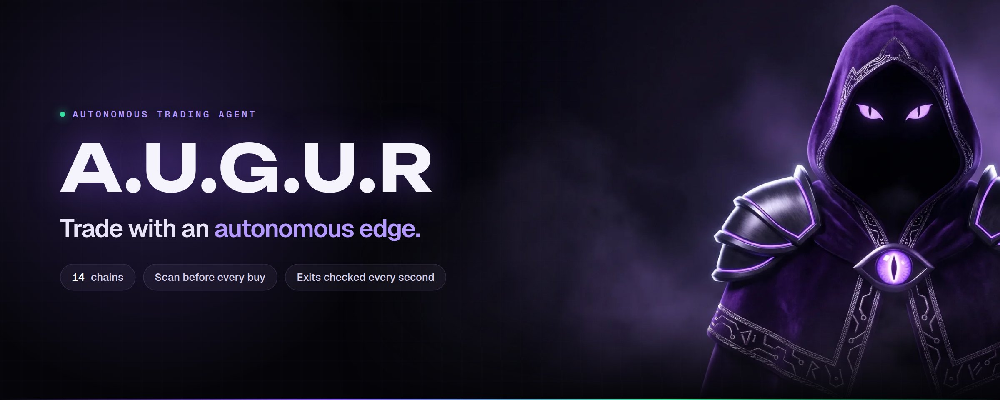</a>

  
  
  
  
  
  

<b>Solana + 13 EVM chains</b> · <b>Scan before every buy</b> <b>Exits checked every second</b> · <b>Browser, Telegram &amp; Android</b>

 

**A.U.G.U.R** (*Autonomous Unit for Gauging Upside &amp; Risk*) is an autonomous trading agent. It reads every token before you buy, executes on the rules you set and manages your exits around the clock.

> [!IMPORTANT]
> **A.U.G.U.R is live.** $AUGUR is trading — the real contract address, chart and live stats are at [augur-trade.com](https://augur-trade.com). Only ever copy the address from augur-trade.com or the pinned post in [t.me/AUGUR_Trade](https://t.me/AUGUR_Trade). No one from the team will ever DM you first.

> [!TIP]
> 📄 **New: the [A.U.G.U.R Whitepaper](WHITEPAPER.md)**, covering the platform, the $AUGUR token, holder rewards, the team supply lock (19.1% locked) and the risks. Also on the web at [augur-trade.com/whitepaper](https://augur-trade.com/whitepaper/) and as a [PDF](docs/whitepaper/augur-whitepaper.pdf).

> [!NOTE]
> This repository is the public showcase for A.U.G.U.R: product tour, docs and brand assets. The trading engine is closed source, so you won't find any code, keys or infrastructure here.

 

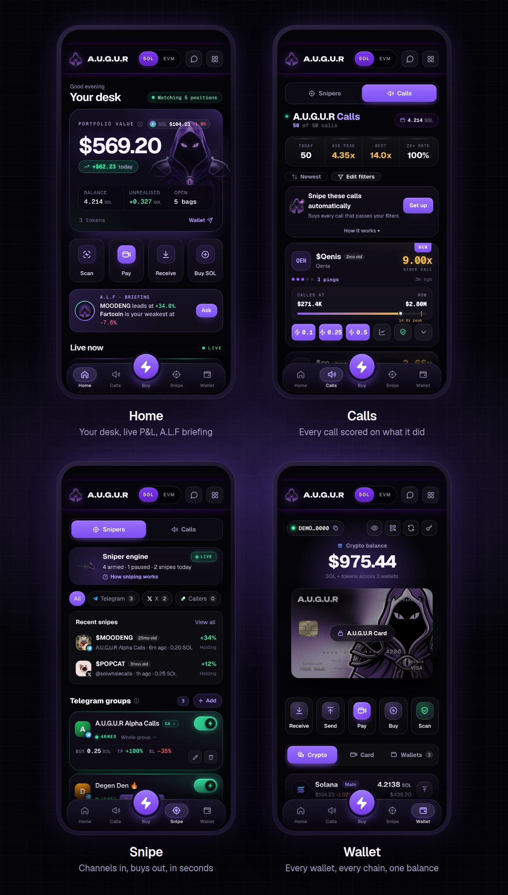

## How it works

Every trade runs through the same four stages, in seconds, on rules you control.

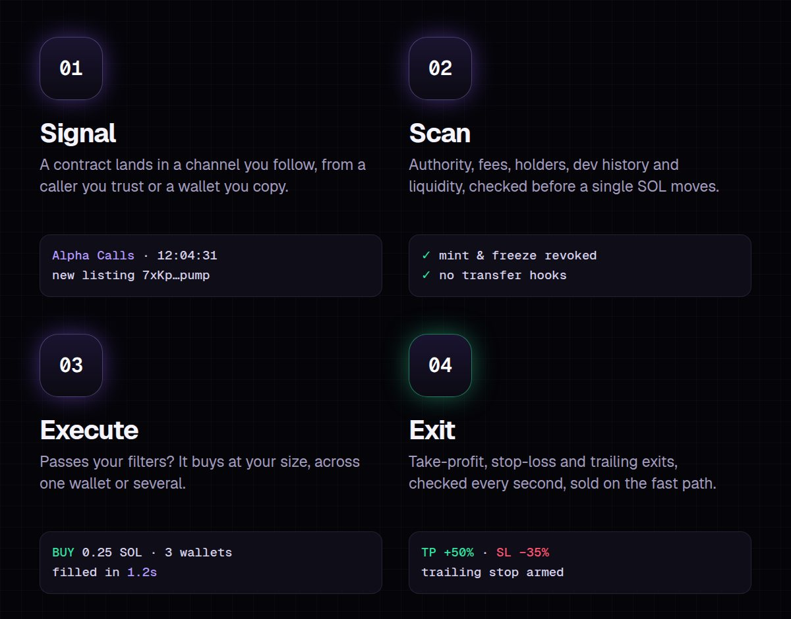

## Platform

#### Channel sniper
Point it at any Telegram group, channel or X account. When a contract address is posted, it buys within your limits before most readers have opened the message.

#### Whale copy
Copy Meteora liquidity whales, ranked by what copying them actually returned. Only the whales copiers are profiting on right now make the default list.

#### Copy trading, graded first
Mirror any wallet with your own size, take-profit and stop-loss. Every wallet gets a copy-backtest grade before you follow, so you know whether copying it would actually have paid.

#### Risk scan on every token
Mint and freeze authority, hidden fees and transfer hooks, holder concentration, developer history, bundles, snipers and liquidity, summed up as one score. It's free.

#### Automated exits
Take-profit, stop-loss, tiered exits and trailing stops for each trade, checked every second and sold on the fast path.

#### Calls, scored
Every call from the channels you follow is tracked from the moment it's posted: peak multiple, hit rate and what it actually did.

#### Flow
Live market flow: the biggest buys on chain as they happen, hourly volume and the coins wallets are piling into.

#### Multi-wallet execution
Run several wallets from one account, buy from many at once, reclaim rent from dead accounts and withdraw anywhere.

#### Multichain, one balance
Solana plus Ethereum, Base, BNB Chain, Arbitrum, Optimism, Polygon, Avalanche, Robinhood Chain, Berachain, Sonic, Linea, Unichain and HyperEVM, with a built-in bridge.

## Whale copy

  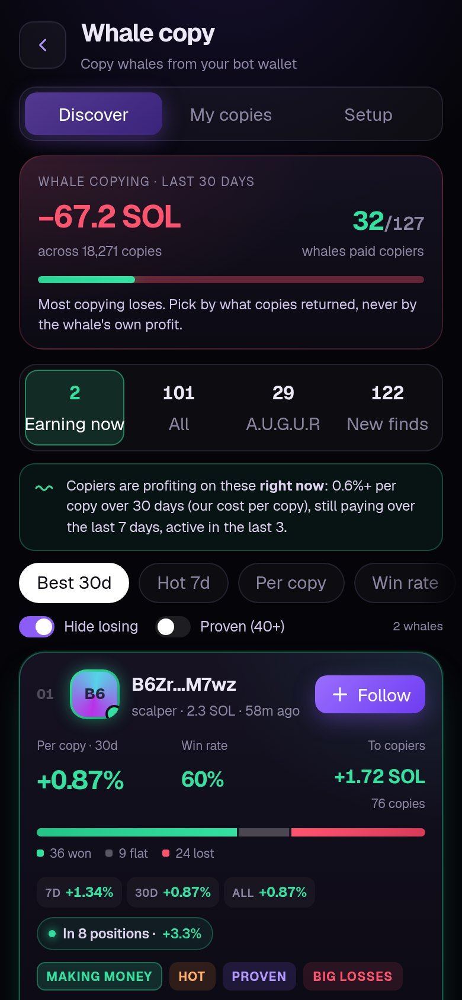
  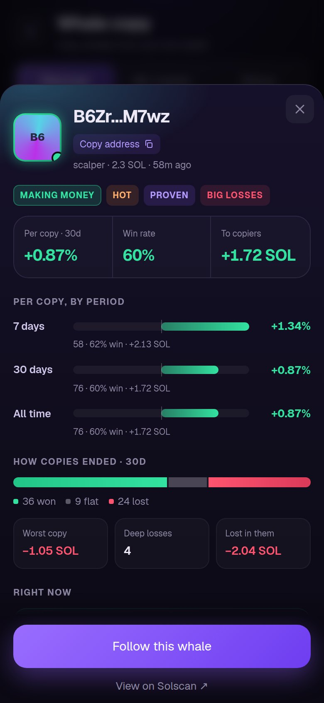
  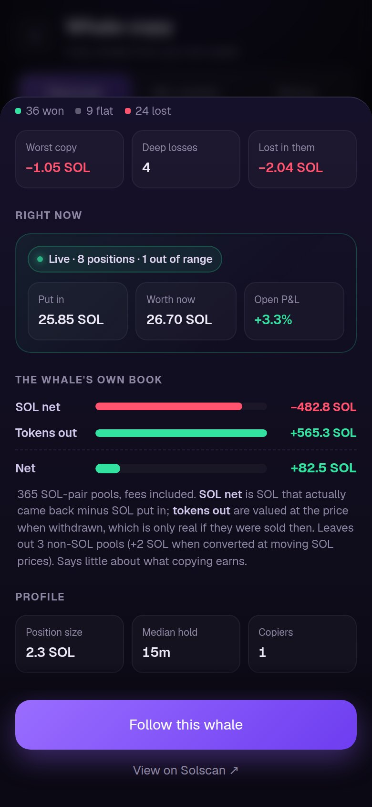

Copy Meteora DLMM liquidity whales from your own bot wallet, at your size, with a stop-loss and a daily loss limit. Whales are ranked by **what copying them actually returned**, never by their own profit, and the default view shows only the whales copiers are profiting on right now. 10% of profit on winning copies, nothing on losses.
[How it works →](docs/features/whale-copy.md)

## Meet A.L.F

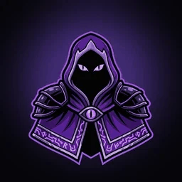

**A.L.F** (*Autonomous Learning Framework*) is the agent inside A.U.G.U.R. Paste any contract address and you get a plain-language read in seconds, built from live on-chain data:

1. **Liquidity and pool health:** depth, locks and how easily you can exit.
2. **Buy pressure:** who is buying, who is selling and how fast.
3. **Holder flow:** concentration, fresh wallets and insiders.

Every read ends in one verdict, **BUY**, **WATCH** or **AVOID**, with the reasoning behind it. On the home screen, A.L.F also briefs you on your open bags.

[Ask A.L.F →](https://augur-trade.com/alf/)

## A.U.G.U.R Auspice

The rug checker behind every A.U.G.U.R buy, free for anyone: ten engines fire in parallel (bundle forensics, the dev's all-time record, insiders, named wallets, contract traps and a dump-probability model) and return one verdict in about a second. Solana and 13 EVM chains.
[Scan a token](https://augur-trade.com/rug/) · engines, model card and free API: **[Augur-Trade/auspice](https://github.com/Augur-Trade/auspice)**

## A.U.G.U.R Foresight

The data behind A.U.G.U.R, opened up to other AI agents: **79 tools** your agent can call over HTTP or MCP and pay for per call with x402 (USDC or SOL on Solana, USDC on Base). That covers pump.fun intelligence, launch and bundle forensics, rug-risk scoring, crypto and DeFi on every chain, and more.
Endpoint reference, specs and SDKs: **[Augur-Trade/foresight](https://github.com/Augur-Trade/foresight)**

## A.U.G.U.R Cards

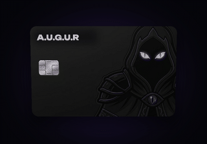

Virtual Visa and Mastercard cards for holders. Top up with SOL from your wallet, then pay online, in apps and in stores through Google Wallet.

- Top up with SOL in one tap
- Freeze, reload or close a card any time
- Six card designs

[See the cards →](https://augur-trade.com/cards/)

## Pricing

| | |
|---|---|
| **Buys** | 2% |
| **Sells** | Free |
| **Subscription** | None. Every feature is included |
| **Risk scan** | Free on every token |
| **Whale copy** | 10% of profit on winning copies, nothing on losses |
| **Referrals** | Invitees get 10% of fees back for 14 days |

## Gallery

  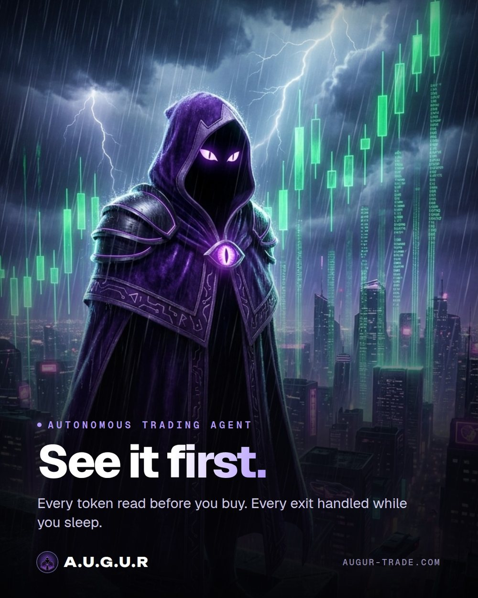
  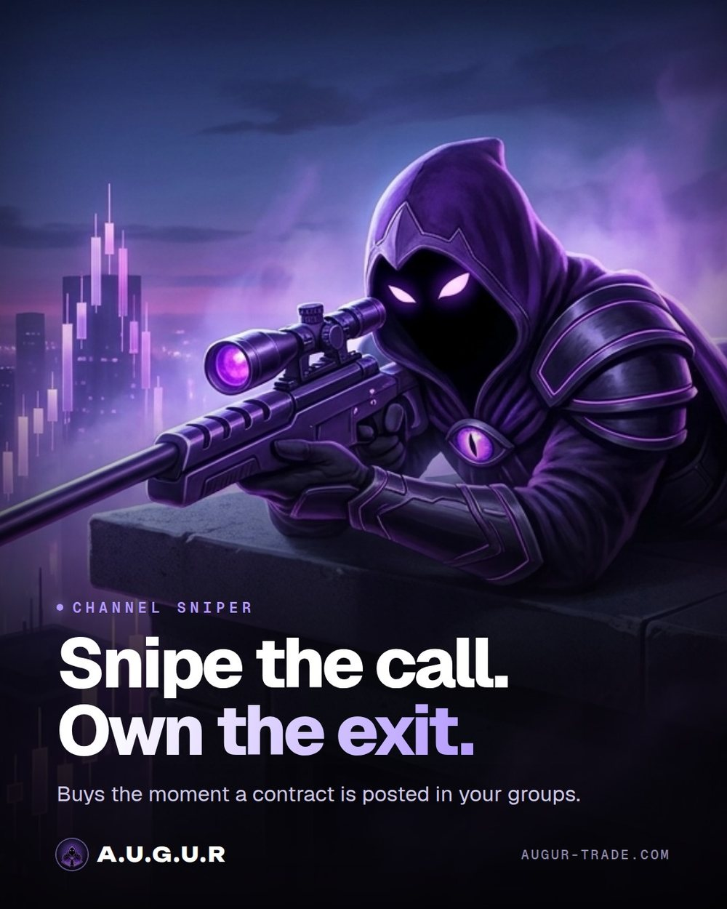

  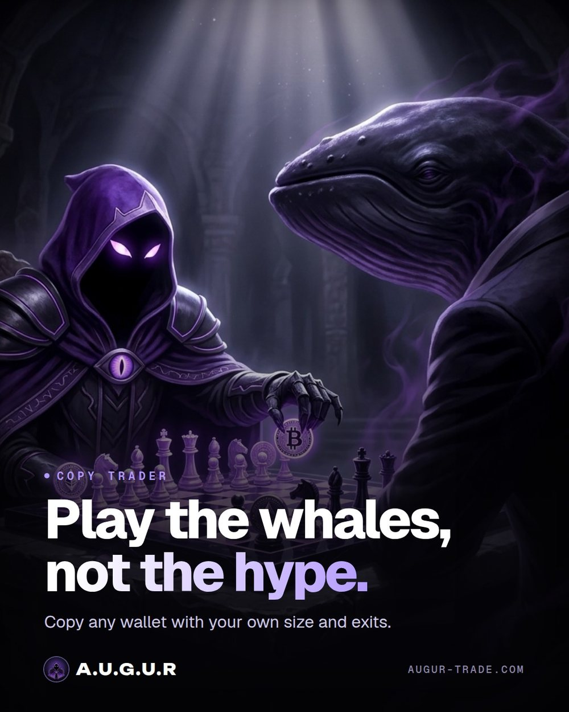
  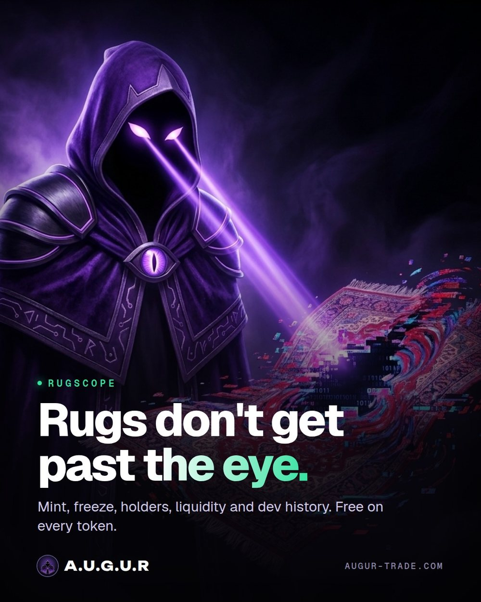

  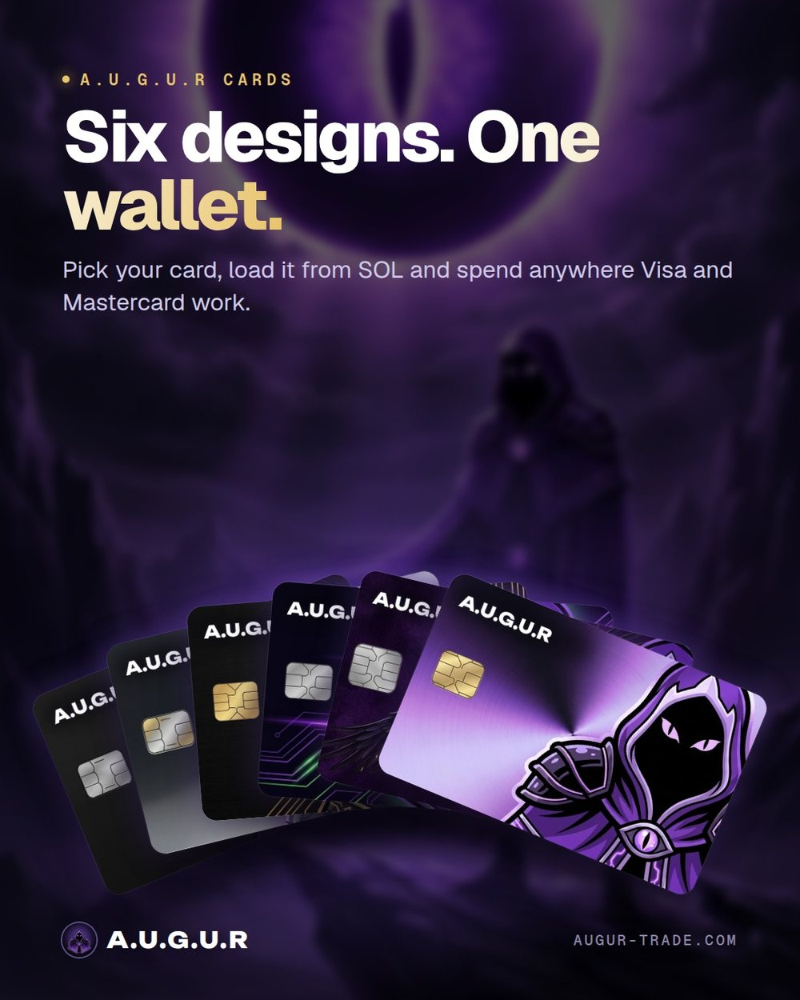
  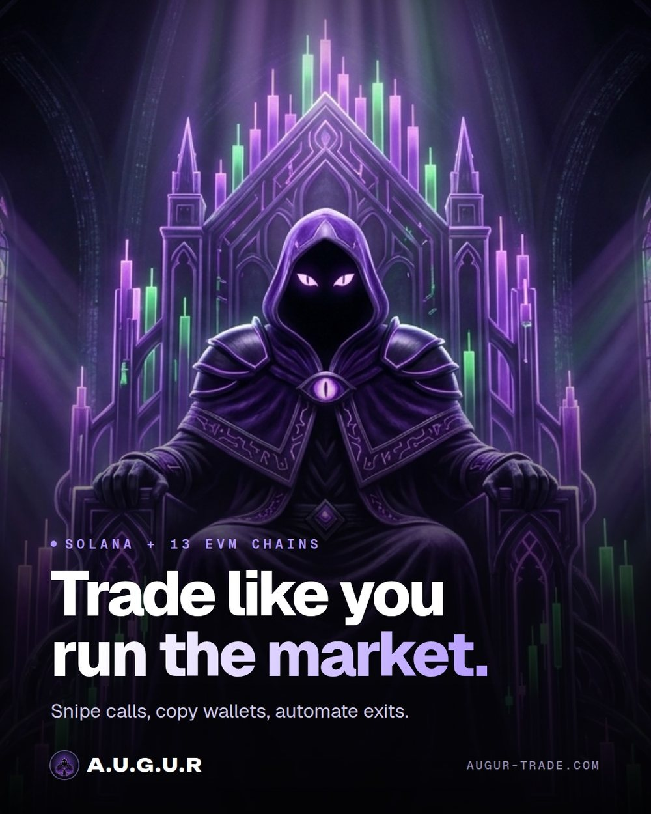

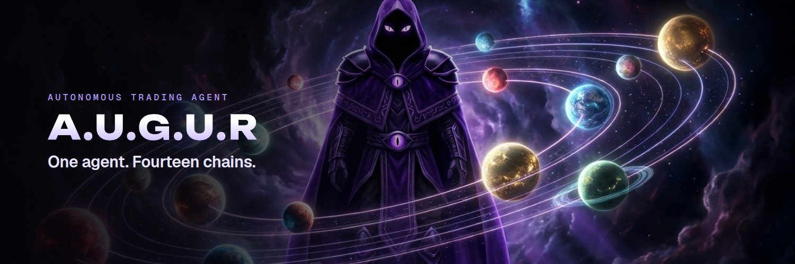

## Documentation

Start with the **[Whitepaper](WHITEPAPER.md)** ([PDF](docs/whitepaper/augur-whitepaper.pdf)). Full docs live in **[docs/](docs/README.md)**:

| Guides | Features | Reference |
|---|---|---|
| [Getting started](docs/guides/getting-started.md) | [Buying and selling](docs/features/buying-and-selling.md) · [Automated exits](docs/features/automated-exits.md) | [Glossary](docs/reference/glossary.md) |
| [App tour](docs/guides/app-tour.md) | [Channel sniper](docs/features/channel-sniper.md) · [Calls and Top Picks](docs/features/calls-and-top-picks.md) | [Changelog](docs/reference/changelog.md) |
| [Platforms](docs/guides/platforms.md) | [Copy trading](docs/features/copy-trading.md) · [Whale copy](docs/features/whale-copy.md) · [Flow](docs/features/flow.md) | [FAQ](docs/FAQ.md) |
| [Staying safe](docs/guides/staying-safe.md) | [Wallets](docs/features/wallets.md) · [Multichain](docs/features/multichain.md) · [Cards](docs/features/cards.md) | [Brand guide](docs/BRAND.md) |
| [Troubleshooting](docs/guides/troubleshooting.md) | [Risk scan](docs/features/risk-scan.md) · [A.L.F](docs/features/alf.md) | |
| | [Pricing and fees](docs/features/pricing-and-fees.md) · [Referrals](docs/features/referrals.md) · [Holder rewards](docs/features/holder-rewards.md) | |

## Learn

- [How to spot a rug pull on Solana](https://augur-trade.com/guides/how-to-spot-a-rug-pull-solana/)
- [How to snipe pump.fun tokens](https://augur-trade.com/guides/how-to-snipe-pump-fun-tokens/)
- [Check a pump.fun dev wallet](https://augur-trade.com/guides/check-pump-fun-dev-wallet/)
- [Mint and freeze authority, explained](https://augur-trade.com/guides/solana-mint-freeze-authority/)
- [Solana bundle checker](https://augur-trade.com/guides/solana-bundle-checker/)
- [Reclaim Solana rent](https://augur-trade.com/guides/reclaim-solana-rent/)
- [Whitepaper](WHITEPAPER.md) · [Full documentation](docs/README.md) · [FAQ](docs/FAQ.md) · [Brand guide](docs/BRAND.md)

## What's in this repo

- **`media/`** · header, app screens, pipeline and social preview
- **`media/screens/`** · app screenshots: Home, Calls, Snipe, Wallet, Whale copy
- **`media/art/`** · posters and banners
- **`media/gifs/`** · A.L.F blink and the card
- **`media/brand/`** · logo, app icon, avatar, banner
- **`docs/`** · [documentation](docs/README.md): guides, features, pricing, glossary, changelog, [FAQ](docs/FAQ.md) and [brand guide](docs/BRAND.md)

 

  <a href="https://augur-trade.com"><b>augur-trade.com</b></a>

Trading crypto is risky. Nothing here is financial advice. A.L.F can be wrong. © A.U.G.U.R. All rights reserved. See <a href="LICENSE">LICENSE</a>.

