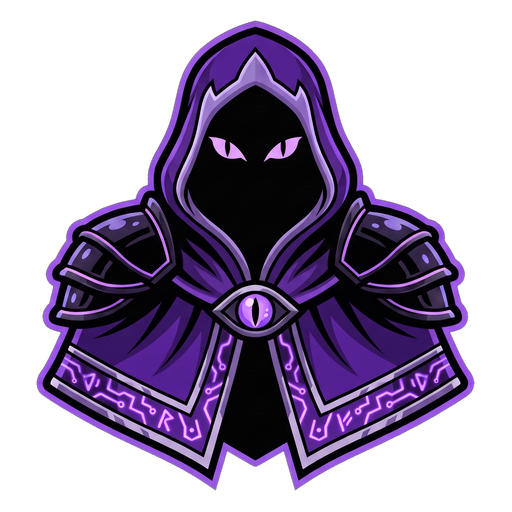

# Brand guide

## Names

| Write | Never |
|---|---|
| **A.U.G.U.R** (the platform) | Augur, AUGUR, A.U.G.U.R. |
| **A.L.F** (the agent inside it) | Alf, ALF, "A.U.G.U.R Agent" |

- A.U.G.U.R = *Autonomous Unit for Gauging Upside &amp; Risk*
- A.L.F = *Autonomous Learning Framework*
- Tagline: **Autonomous trading agent**

## Colour

| Token | Hex | Use |
|---|---|---|
| Night | `#050509` | Background |
| Panel | `#0c0a13` | Cards |
| Violet | `#8b5cf6` | Brand, primary actions |
| Lilac | `#b49aff` | Accents, links, the eyes |
| Mint | `#33e2a0` | Profit, live |
| Red | `#ff5470` | Loss |
| Gold | `#e8b64f` | Highlights |
| Text | `#f5f3fc` | Headings |

## Type

- **Unbounded**: the wordmark only
- **Geist**: headings and body
- **Geist Mono**: numbers, prices, labels

## Assets

| File | Size |
|---|---|
| [`logo-512.png`](../media/brand/logo-512.png) | 512 × 512 |
| [`app-icon-1024.png`](../media/brand/app-icon-1024.png) | 1024 × 1024 |
| [`pfp-1024.png`](../media/brand/pfp-1024.png) | 1024 × 1024, profile picture |
| [`banner-1500x500.jpg`](../media/brand/banner-1500x500.jpg) | X / Telegram header |
| [`social-preview.jpg`](../media/social-preview.jpg) | 1280 × 640 link card |

The character art, logo and card designs are © A.U.G.U.R. Please don't modify them or use them to imply an endorsement.
