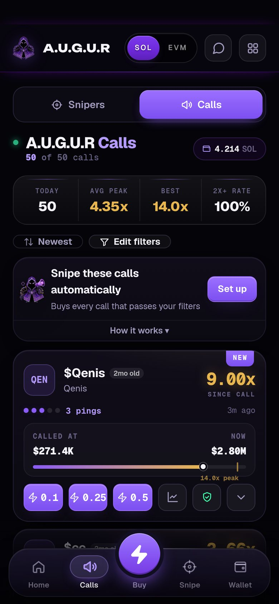

# Calls and Top Picks

## Calls

Every contract address posted in the channels you follow lands in **Calls**, scored on what it actually did after the call: peak multiple, current multiple and how fast it moved.

Each call card shows:
- the token, the caller and how long ago it was called
- market cap and liquidity at the call and now
- **peak ×** and **now ×**
- a **safety ring**: the risk-scan score, the verdict and the top flag. Tap it for the full scan

## Filters

Open **Filters** to choose which calls you see and which ones auto-buy.

**Entry rules** (what qualifies):
- **Pump.fun only**: contract addresses ending in `pump`
- market cap and liquidity range, minimum liquidity as a % of market cap
- minimum transactions, minimum and maximum token age
- maximum pings
- must have an X account, a Telegram or a website
- blocked words
- **Scan guard**: hide or skip tokens the risk scan says to avoid (**Avoid**), or require a minimum scan score (**Strict**)

**View rules** (what you see, on this device only): called within the last N hours, minimum current multiple, minimum peak multiple.

**Presets:** *Pump.fun fresh*, *Deep pool*, *Synapse safe*, *Safer*, or *Clear rules*.

The match bar shows how many calls passed, and a tally of why the others were skipped.

> [!NOTE]
> If a filter shows a gold "not applied to auto-buy yet" note, it only affects what you see so far, not what auto-buys. The note disappears once it applies to both.

## Auto-buy

Turn on **auto-buy** in Filters to buy every call that passes your entry rules, at your Calls size with your Calls exits.

## Callers

**More → Callers** ranks pump.fun callers on real results: how their calls performed after posting, not how loud they are.

## Top Picks

**Top Picks** (on Home) are coins scored by A.U.G.U.R's pick model. For fresh pump.fun coins it looks at the coin's state *right now*: trading activity, buyers and sellers, holders, liquidity, and how its curve is moving. It outputs a score from 0 to 100:

| Score | Grade |
|---|---|
| 90+ | 🔥 Fire |
| 75+ | Strong |
| 50+ | Watch |

Coins outside what the model was trained on (older or graduated coins) are capped at 74.

Picks also go through a rug filter that drops coins under about $12K market cap, failed scans and sell-heavy or whale-dominated tape.

> [!IMPORTANT]
> **How good is it?** In testing on fresh days it never saw, picking the model's top 20% cut the rug rate (from about 32% to 27%) and the average loss (from about −5% to −2%) compared with simple rules. **No score band was profitable after fees.** Top Picks narrow the field. They don't guarantee a winner. The model is retrained and re-validated on fresh data before any change goes live.

You can auto-buy Top Picks from the Snipe tab. See [Channel sniper → Snipe Top Picks](channel-sniper.md#snipe-top-picks).
