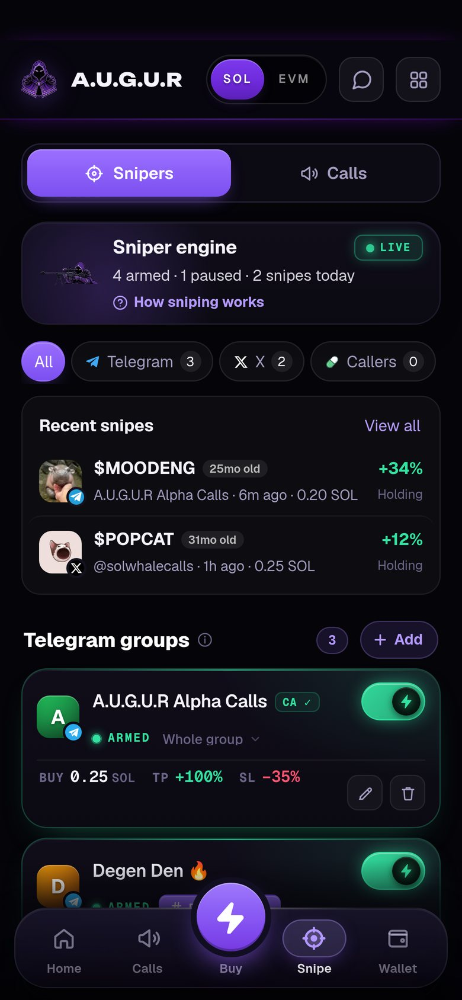

# Channel sniper

Point a sniper at a Telegram group, a Telegram channel or an X account. When a contract address is posted, it buys within your limits, usually before most readers have opened the message.

## Adding a sniper

**Snipe → Add**, then choose:
- **Telegram group or channel**: add the group or channel. For groups with topics, choose which thread to watch.
- **X account**: enter the handle.

Each sniper has its own:
- **Buy size**
- **Take-profit, stop-loss and tiers** (see [Automated exits](automated-exits.md))
- **Armed / paused** switch (the bolt). Arming plays a sound so you know it's live

## Sniper cards

Armed snipers sit first. Each card shows the source (TG or X), the thread being watched, the buy/TP/SL strip and edit and delete buttons. If the same group is added more than once, the card says so, because **every armed copy buys**.

## The rug guard

Before any snipe buys, the token goes through a rug guard, which **fails closed**: if it can't check, it doesn't buy. A snipe is skipped when:

- the developer launched another token in the previous 24 hours (serial launcher)
- the top 10 holders own more than 35% of supply
- wallets that bought in the launch block also bundled this developer's earlier launches
- launch-block buys took more than 20% of supply
- a third-party scan flags it as dangerous, insiders hold more than 15%, or more than 10% sits with wallets that never bought (it was transferred to them)

> [!NOTE]
> In our own testing, the guard roughly halved stop-outs and cut rugs by about a third on held-out data. It did not make snipes profitable on its own. Most fresh launches lose money, guard or not.

## Snipe Top Picks

Instead of a channel, snipe A.U.G.U.R's own **Top Picks**: coins the pick model scores highly. Set a minimum score (90 = "fire" by default), how many to take, and the buy size and exits. See [Calls and Top Picks](calls-and-top-picks.md#top-picks).

## Recent snipes

The Snipe tab lists your recent snipes so you can see what each sniper bought.

## Tips

- Snipe sizes add up fast in an active channel. Keep enough SOL for several snipes plus fees, or the later ones fail.
- Fills on hot calls are often well above the price at the moment of the call. Set your stop-loss with that in mind.
- One sniper per source is usually enough.
