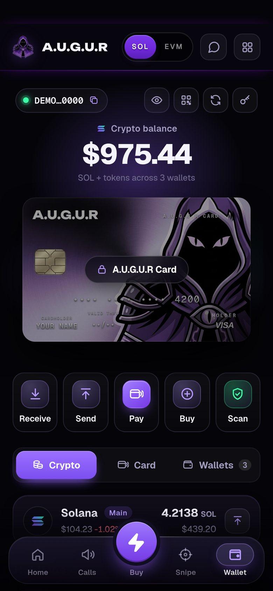

# Wallets

## Bot wallets

Trades are signed by **bot wallets**, so buys and sells land in under a second without a pop-up for every trade.

- You get a **Main** wallet and can add **up to 8 more**.
- **They're yours.** Export any wallet's private key from Wallet and import it into Phantom or any other Solana wallet.
- Choose which wallets are **active**. Buys fan out to the active set, or pick per buy with the **Buy from** picker.
- **Make main** swaps which wallet is Main.

## Moving SOL

**Move SOL** sends SOL between your own wallets, or to any address:
- From / To pickers with a flip button
- 25% · 50% · Max chips, plus **Keep 0.01** when the wallet has open positions (so it can still pay to sell them)
- **Collect into Main** sweeps the spare SOL from every wallet into Main in one go

The app checks fees and the rent minimum first, and tells you exactly which transfers failed, if any.

## Sending tokens

**Send** works for **any token** in any of your wallets:
1. Pick the wallet, the token and the amount (% chips, Max, or type it in SOL or USD)
2. Paste the destination, pick one of your own wallets, or choose a recent address
3. Review: network fee, any new-account deposit for the recipient, and rent you'll get back from accounts the send empties
4. **Hold to send**

Your key never leaves your device for this. The transaction is signed in the app.

Tokens that can't be transferred safely (frozen, non-transferable or with transfer hooks) are refused before anything is sent.

## Holdings

Wallet lists every token you hold with a market price and real liquidity, with logos and live values. Spam airdrops without a market stay hidden. Tap **+ Track** on a holding to turn it into a managed position with exits.

Your SOL balance is read from the chain itself.

## Rent, and reclaiming it

Solana keeps a small deposit (about 0.002 SOL) on every token account you open. When a token goes to zero and you're left with an empty account, that deposit sits there until the account is closed.

**Reclaim rent** finds your empty token accounts and closes them, returning the SOL. With dozens of dead memecoins, this adds up.

A wallet itself must stay at **0 SOL or at least about 0.00089 SOL**. Solana rejects transfers that would leave it in between.

## Connect wallet (read-only)

**Connect wallet** with Phantom or Solflare signs you in with your real balances in view. It's read-only: to trade, create a bot wallet and fund it from your connected wallet.
