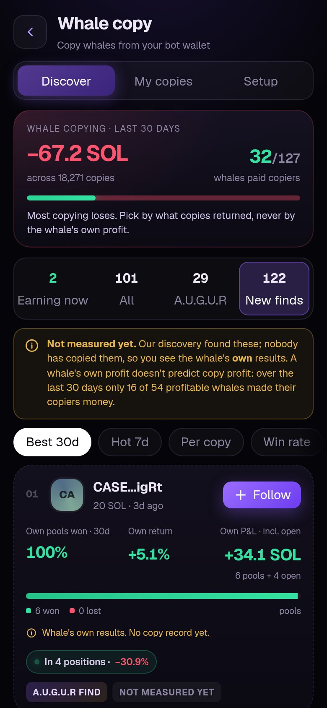

# Whale copy

Copy the liquidity positions of Meteora DLMM "whales" from your own bot wallet, automatically, at your size and with your risk limits.

  
  
  

Open it from the **Whale copy** card on Home, or **More → Whale copy**.

> [!IMPORTANT]
> **Most whale copying loses money.** The top of the Discover screen shows the live market number. On 17 October 2026, copiers across the market had lost about 67 SOL over 18,000 copies in 30 days, and only 32 of 127 whales made their copiers money. Whale copy is built to show you which whales are worth copying, and that is usually very few.

## What a whale is, and what copying means

A **whale** here is a wallet that provides liquidity on [Meteora DLMM](https://meteora.ag) pools at size. It deposits SOL (and sometimes the token) across a range of price bins and earns a share of the trading fees whenever the price moves through them.

When a whale you follow **opens a new position**, A.U.G.U.R opens a matching position from your bot wallet:
- in the **same pool**
- over the **same price range**
- with liquidity spread across the bins in the **same shape** as the whale's
- at **your size**, not theirs

When the whale **exits**, your copy exits too.

## Discover: choosing whales

### The four views

| View | What's in it |
|---|---|
| **Earning now** | Whales copiers are profiting on *right now* (criteria below). This is the default. Some days it's only one or two whales, and some days none. |
| **All** | Every whale with a measured copy record. |
| **A.U.G.U.R** | Whales A.U.G.U.R's own engine copies with real money or has copied, plus our discovery finds that have a measured record. |
| **New finds** | Whales our discovery found that nobody has copied yet. You see the whale's **own** results, clearly marked as unmeasured (see [why that matters](#why-the-whales-own-profit-isnt-used-to-rank)). |

### "Earning now" criteria

A whale is listed as **Making money** only if all of these are true:

1. Copies over the last **30 days** returned **at least 0.6% per copy** (roughly the round-trip cost of a copy), over **20 or more copies**, with positive SOL returned overall.
2. It's still opening positions people can copy: **5 or more copies in the last 7 days**, returning **at least 0.3% per copy**.
3. It has traded in the **last 3 days**.

A whale with a great lifetime record that has stopped opening new positions drops out of this view, because there's nothing to copy.

### Reading a whale card

- **Rank** and **avatar**. The ring around the avatar glows when the whale traded in the last hour, is dim within the day, and greys out after that.
- **Style · position size · last active**: for example, "scalper · 2.3 SOL · 47m ago".
- **Per copy**: the average return of one copy, in % of what went in.
- **Win rate**: the share of copies that closed in profit.
- **To copiers**: the total SOL copiers actually got back, with the number of copies.
- **Outcome bar**: how copies ended: won, flat or lost.
- **7D / 30D / ALL** pills: per-copy return by period. A whale whose 7-day number is far below its 30-day number is cooling off.
- **Live chip**: whether the whale is in a position right now, and how that position is doing.

### Tags

| Tag | Meaning |
|---|---|
| **Making money** | Passes the Earning now criteria above |
| **Hot** | 7-day copies returned 1%+ per copy over 8+ copies |
| **Consistent** | 30-day win rate 60%+ over 20+ copies, with 2 or fewer deep losses |
| **Proven** | 40+ copies all time. Records under that are too small to trust |
| **Cooling off** | The last 7 days are less than half the 30-day per-copy return (20+ copies) |
| **Thin edge** | Positive, but under 0.6% per copy, so copy costs can eat it |
| **Big losses** | A copy lost 1 SOL or more in 30 days, or 10+ deep losses all time |
| **Losing 30d** | Copiers lost money on it over 30 days |
| **Quiet** | No activity in 3 days |
| **A.U.G.U.R copies it** | Our own engine is copying it with real money |
| **A.U.G.U.R find** | Found by our own whale discovery |
| **Not measured yet** | Nobody has copied it, so there is no copy record |

### Sorting and filters

Sort by **Best 30d** (the default ranking), **Hot 7d**, **Per copy**, **Win rate** or **Most copied**. **Hide losing** removes whales whose copiers are down. **Proven (40+)** keeps only records with 40+ copies.

### The whale detail

Tap any whale to see:
- **Per copy · win rate · to copiers** for its best window.
- **Per copy, by period**: 7 days, 30 days and all time as bars that grow from the middle, so decay is visible at a glance.
- **How copies ended**: the outcome bar, the worst single copy, the number of deep losses and what they cost.
- **Right now**: its open positions, what went in, what they're worth and the open P&L.
- **The whale's own book** (explained below).
- **Profile**: typical position size, median hold time and the number of copiers.

## Where the numbers come from

| Number | Source | Refreshed |
|---|---|---|
| Copy results (per copy, win rate, to copiers, outcomes) | Measured results of real copies: [whaletails.fun](https://whaletails.fun)'s copy records, and for whales they don't track, A.U.G.U.R's own engine copying with real money | Every 15 minutes |
| A.U.G.U.R users' results | Every closed copy made by A.U.G.U.R users | Every 15 minutes |
| Right now (open positions) | Meteora, live | Every 15 minutes |
| Last active | The whale's latest transaction on chain | Every 15 minutes |
| The whale's own book | The whale's full per-pool history on Meteora | Daily |
| New finds' own 7d/30d record | The whale's per-pool history on Meteora | Hourly |

### Why the whale's own profit isn't used to rank

It's tempting to rank whales by how much *they* made. **It doesn't predict what copiers make.**

We measured it on 62 whales that have both a 30-day record of their own and a 30-day copy record:

- The rank correlation between a whale's own return and its copiers' return was **+0.01**, effectively zero.
- Of 54 whales that made money themselves, only **16** made their copiers money.
- Even whales that returned over 1% and won 60%+ of their pools gave copiers **−0.39%** on average.

A whale enters first, at its own size, can sit through drawdowns and can afford churn that a copier pays for. That's why Discover ranks by **measured copy results**, and why **New finds** sit in their own tab marked unmeasured.

### The whale's own book: SOL vs tokens

Meteora shows each wallet a lifetime "total P&L". It's misleading for two reasons, so we don't show it:

1. **It mixes in non-SOL pools** (USDC pairs, for example), converted to SOL at whatever the SOL price was at the time. When SOL's price moves, a flat dollar position shows up as SOL profit or loss. In one case we checked, +285 of a whale's +360 SOL "profit" came from a single USDC-pair pool.
2. **It counts tokens at the price when withdrawn.** DLMM positions turn SOL into the token as the price falls through the range. A whale that withdraws tokens gets them valued at that moment, which is only real if it sold them straight away.

So the detail shows the book for **SOL pairs only**, split three ways:

| Line | Meaning |
|---|---|
| **SOL net** | SOL that actually came back (withdrawals + fees in SOL) minus SOL put in |
| **Tokens out** | Tokens withdrawn (and token-side fees), valued at the price when withdrawn, minus tokens deposited |
| **Net** | The two together |

Out of 40 whales checked, **38 had a negative SOL net**: they got back less SOL than they put in, and their entire "profit" was token value at withdrawal time. Treat any whale's own profit with care.

## Setting up

**Setup** has four steps:

1. **Wallet**: pick which bot wallet copies trade from. A separate wallet funded just for whale copy is best, so your snipes and copies never compete for SOL. Each open copy needs about **your size + 0.06 SOL position rent** (refunded on close) **+ a 0.05 SOL reserve** for exits.
2. **Risk limits**:

   | Setting | Range | Default |
   |---|---|---|
   | Size per copy | 0.1 – 5 SOL | 0.5 SOL |
   | Stop loss | 5 – 90% | 25% |
   | Max open copies | 1 – 5 | 2 |
   | Daily loss limit | 0.1 – 25 SOL | 1 SOL |

   The most you can have at risk at once is size × max open copies.
3. **Whales**: follow up to **10** from Discover.
4. **Fees**: read them (below), then **Start copying**. The first time, you accept a short risk notice.

## How a copy runs

### Opening

A copy opens when a whale you follow opens a **new** position and all of these hold:

- The whale committed real size: **at least 2 SOL**. Smaller deposits are often tests.
- The token passes A.U.G.U.R's token check, including transfer-fee and quality screens.
- Opening doesn't need more than about **0.09 SOL** of one-off, non-refundable pool setup costs.
- You don't already have a copy of that whale open (**one copy per whale** at a time).
- You're under your **max open copies** and haven't hit today's **daily loss limit**.
- Your wallet can cover the copy, the rent and the reserve. If it's short, a copy can open at down to **half your size** (never below 0.1 SOL). If it can't cover that, it's skipped.

Copies are built and checked before they're sent, so nothing reaches the chain unless it will work.

### While it's open

- **Live P&L**: My copies shows what went in, what it's worth now, fees earned and a meter from your stop line to the same distance in profit.
- **Fees**: when the whale claims its fees, your copy claims too (once there's enough to be worth the transaction).
- **Partial removes don't close you out.** A whale trimming its position isn't an exit. Your copy closes when the whale fully exits.

### Closing

A copy closes when:
- the whale **fully exits** its position
- your **stop loss** is hit
- you tap **Close** (or **Close all**)

On close, your liquidity is withdrawn, fees are claimed, the position account is closed (its rent comes back), and the token side is sold back to SOL. **Only the tokens that copy returned are sold.** If you hold the same token separately, your own balance is left alone.

### Pausing

Turning copying **off** stops new copies. **Copies already open keep being managed**: they still close when the whale exits or the stop is hit. Refusing to exit is never a safety feature.

## Your results

**My copies** shows:
- Realized P&L, today's P&L and your win rate
- Number of copies, SOL deployed and fees paid
- Each open copy, live
- History: every closed copy with its result, why it closed (whale exited, stop loss, you closed), any fee, and a link to the transaction

**Every number comes from that copy's own transactions on chain.** Your bot wallet may also be sniping or trading, so the app never works results out from your wallet balance. A snipe landing at the same time can never be counted as copy profit.

## Fees

- **10% of the profit on each winning copy**, sent from your wallet when the copy closes.
- **Nothing on losing or break-even copies.**
- No fee is charged unless the copy's profit was confirmed from its own transactions.
- If the fee transfer fails (for example, the wallet is momentarily short), it's recorded as pending and retried.
- Network fees and position rent are paid by your wallet as usual. Rent comes back on close.

See [Pricing and fees](pricing-and-fees.md).

## When a copy won't open

| You see | Why | What to do |
|---|---|---|
| **Not set up** | No wallet chosen | Setup → Wallet |
| **Paused** | Copying is off | Turn it on in My copies or Setup |
| **On hold** | A close didn't complete, so new copies are held while it's retried | Check My copies for the reason. Open copies are still managed |
| **Wallet issue** | The chosen wallet can't be used | Pick another wallet in Setup |
| Active but nothing opens | Your whales haven't opened new positions, their deposits were under 2 SOL, the token failed the check, you're at max open copies or today's loss limit, or your wallet is short | Check the whales' "last active" and Live chips, your open copies and your wallet balance |

## Risks

- Liquidity positions lose value fast when the token dumps (impermanent loss). Fees often don't make up for it.
- Copies open seconds after the whale, at a different size, so your result differs from theirs.
- A stop loss limits losses but can't guarantee the exit price in a crash or a thin pool.
- Whales go cold, sometimes within days. Re-check who you follow.
- Copies run 24/7, even with the app closed.

---
Past results don't guarantee future results. Nothing here is financial advice.
